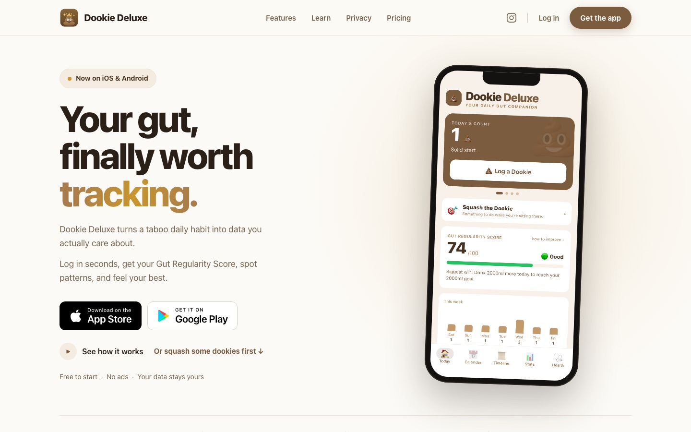
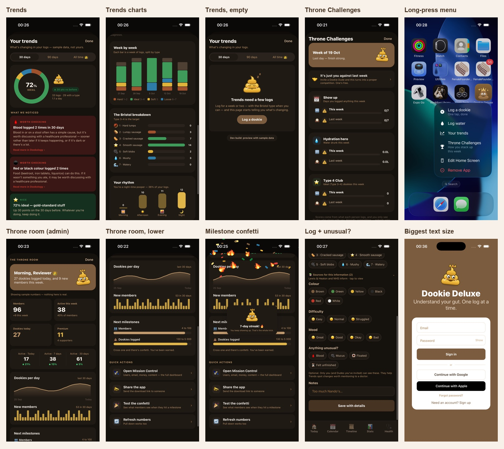
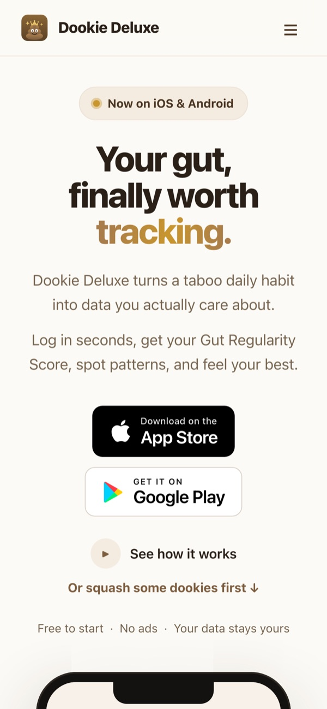

# 💩 Dookie Deluxe

**Your gut, finally worth tracking.** A gut-health tracker for iPhone and Android that turns a taboo daily habit into data people actually care about, with a sense of humour and a golden mascot.

> This is a case study. The source code is private because it's a commercial product. I'm happy to walk through it in an interview.

## What it does

- **Log in seconds:** one-tap Quick Log, or a detailed log with the Bristol scale, colour, difficulty, mood, notes and anything unusual.
- **Gut Regularity Score** out of 100, with the biggest thing you could change today.
- **Trends:** week-by-week charts, the Bristol breakdown and your daily rhythm, plus gentle "worth checking" flags (for example, blood logged twice in 30 days) that link to plain-language health reading.
- **Calendar, timeline and stats,** plus water and medication tracking and a PDF report to take to a doctor.
- **Dookie Dudes and Throne Challenges:** invite friends and compete on streaks, hydration and "Type 4 Club" weeks. Notes stay private unless you share them.
- **The Throne Room, for admins:** live member and activity stats, milestones with confetti, and quick actions.

## What I built

- **Expo / React Native app** with Expo Router, NativeWind and TanStack Query, live in the App Store and on Google Play.
- **Native touches:** haptics, frosted pop-up sheets, gradients, a long-press app-icon menu, an offline banner, Dynamic Type and VoiceOver labels.
- **Privacy by default:** Supabase row-level security means each person sees only their own logs. Friends see only what's been shared with them, and notes start private.
- **Premium:** a freemium plan with a gentle paywall. The website takes donations in rand through Paystack.
- **A website** with the story, a short game ("squash some dookies") and the store links.

## Stack

| Layer | Choice |
| --- | --- |
| App | Expo SDK 54, React Native 0.81, TypeScript, Expo Router, NativeWind |
| Data | Supabase (Postgres, Auth, row-level security), TanStack Query |
| Server | Netlify Functions (admin, email digests, account deletion, payments) |
| Payments | Paystack (ZAR) |
| Builds | EAS Build and Submit, over-the-air updates, Sentry |
| Website | Netlify |

## Built by

**Matthew Gift Luis**, founder of [Godji Tech](https://godjitech.com) in Midrand, South Africa.

[Portfolio](https://webdevmatt-dot.github.io/portfolio/?r=git) · [godjitech.com](https://godjitech.com)
